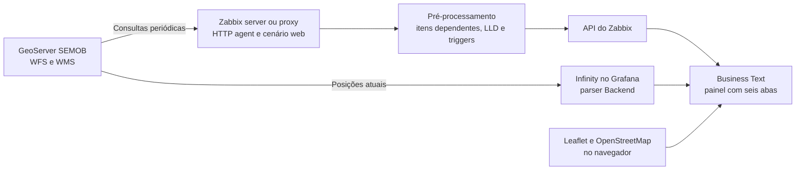

# SEMOB DF, frota de ônibus no Zabbix e no Grafana

Template Zabbix 7.0 e dashboard Grafana para os dados públicos do GeoServer da SEMOB, a Secretaria de Transporte e Mobilidade do Distrito Federal.

O template coleta as posições GPS dos ônibus, o cadastro da frota, o catálogo de camadas e a disponibilidade do serviço. O dashboard mostra o mapa da frota e as estatísticas em um painel com seis abas, em tema claro.

## Conteúdo do repositório

| Caminho | Conteúdo |
|---|---|
| `zabbix/template_semob_df_geoserver_http.yaml` | Template `SEMOB DF GeoServer by HTTP` para importar no Zabbix |
| `grafana/dashboard_semob_df.json` | Dashboard para importar no Grafana |
| `grafana/src/` | JavaScript, CSS e logo do painel, em arquivos editáveis |
| `docs/` | Instalação, arquitetura, dados da SEMOB, operação e desenvolvimento |
| `tools/` | Sincroniza o painel com o JSON e gera a referência do template |
| `tests/` | Testes do template, dos scripts, do dashboard e do painel |

Os guias completos estão em [Instalação](docs/instalacao.md), [Arquitetura](docs/arquitetura.md), [Dados da SEMOB](docs/dados-semob.md), [Operação](docs/operacao.md), [Desenvolvimento](docs/desenvolvimento.md) e [Referência do template](docs/referencia-template.md). A [galeria](docs/galeria.md) relaciona todas as capturas aos respectivos procedimentos.

## Como funciona



O Zabbix executa as consultas, sem agente no destino. As respostas completas, com cerca de 1 MB, ficam só em memória. O que vai para o banco são indicadores numéricos extraídos no pré-processamento.

O mapa não passa pelo Zabbix. O Grafana lê as posições direto do GeoServer pelo plugin Infinity, porque o widget de mapa do Zabbix posiciona apenas hosts do inventário.

## Requisitos

| Componente | Versão |
|---|---|
| Zabbix server ou proxy | 7.0, testado em 7.0.31 |
| Grafana | 11 ou superior, exigência do Business Text 6.1 |
| Plugin Zabbix para Grafana, `alexanderzobnin-zabbix-app` | Formato das consultas conferido no código da 6.9.1 |
| Plugin Infinity, `yesoreyeram-infinity-datasource` | Formato das consultas conferido no código da 4.1.1 |
| Plugin Business Text, `marcusolsson-dynamictext-panel` | Opções do painel conferidas no código da 6.1.0 |
| Rede do Zabbix e do Grafana | HTTPS para `geoserver.semob.df.gov.br` |
| Rede do navegador | HTTPS para `cdnjs.cloudflare.com`, `tile.openstreetmap.org` e, opcionalmente, `fonts.googleapis.com` |

As versões mínimas que o JSON do dashboard declara em `__requires` não foram testadas. A fonte Inter vem do Google Fonts e, sem acesso, o painel usa a fonte do sistema.

Sem acesso ao `cdnjs.cloudflare.com`, o painel mostra a dispersão das coordenadas, sem mapa. Sem acesso ao `tile.openstreetmap.org`, os pontos aparecem sobre um fundo vazio.

## Instalação resumida

O passo a passo completo, com comandos, está em [docs/instalacao.md](docs/instalacao.md).

1. Teste o acesso ao GeoServer a partir do servidor Zabbix e do servidor Grafana.
2. Importe `zabbix/template_semob_df_geoserver_http.yaml` em Data collection, Templates.
3. Crie o host `SEMOB DF`, sem interface, com o template vinculado.
4. Execute os itens mestres e a descoberta de operadoras para não esperar o primeiro intervalo.
5. No Grafana, instale os plugins e crie o data source Infinity com `https://geoserver.semob.df.gov.br` em Allowed hosts.
6. Importe `grafana/dashboard_semob_df.json` e escolha os data sources Zabbix e Infinity.

## O que o dashboard mostra


*Figura 1. Painel Grafana com indicadores de veículos e mapa. Captura histórica, não indicador em tempo real.*

Seis indicadores ficam fixos no topo e as abas trocam o conteúdo abaixo deles.

| Aba | Conteúdo |
|---|---|
| Mapa da frota | Um ponto por veículo na cor da empresa, traço de rumo, busca por linha ou prefixo e filtro por empresa |
| Empresas | Participação na frota em circulação, perfil operacional comparado e quadro por empresa |
| Linhas | Linhas com mais veículos, velocidade por tamanho da linha e tabela das maiores linhas |
| Qualidade e disponibilidade | Velocidade, idade do sinal, rumo, tempo de resposta do GeoServer e consistência dos dados |
| Cadastros | Frota cadastrada, cadastro contra circulação e catálogo de camadas |
| Problemas | Triggers ativas do host, com severidade e duração |

As cores seguem a identidade das empresas.

| Empresa | Cor |
|---|---|
| Piracicabana, Bacia 1 | Verde |
| Pioneira, Bacia 2 | Amarelo |
| Urbi, Bacia 3 | Azul |
| Marechal, Bacia 4 | Laranja |
| São José, Bacia 5 | Marrom escuro |
| Coobrataete | Cinza |
| Outros | Vermelho |

O template também inclui um dashboard próprio, com duas páginas, para quem usa só o Zabbix.

## Privacidade

Os permissionários do transporte rural são pessoas físicas. O template e o dashboard não publicam os nomes deles. A frota deles é somada em uma única entrada e os veículos aparecem como Outros.

O template não coleta o IMEI do rastreador nem a placa dos veículos.

## Testes

```bash
pip install -r tests/requirements.txt
npm ci --prefix tests
python tools/sync_panel.py --check
python tools/gerar_referencia.py --check
python tests/test_template.py
python tests/test_scripts.py
python tests/test_dashboard.py
npm test --prefix tests
```

Os testes cobrem a estrutura do template, os scripts no motor Duktape do Zabbix, a consistência entre dashboard e template e o painel em jsdom com Leaflet. Detalhes em [docs/desenvolvimento.md](docs/desenvolvimento.md).

## Limitações conhecidas

As capturas da pasta `galeria/` registram estados observados do Zabbix e do Grafana. Números, horários e alertas exibidos nelas não são valores atuais do GeoServer.

- A SEMOB não publica dicionário da API, limites de uso, SLA nem licença de reutilização.
- O mapa mostra só a última posição de cada veículo. Trajetos exigem um coletor que grave o histórico.
- O campo `datalocal` das posições não é usado, porque o fuso não é confirmado.
- Os dados de passageiros ficam fora da descoberta de camadas, porque consultas sem filtro passaram de 20 segundos.

A lista completa e as hipóteses não confirmadas estão em [docs/dados-semob.md](docs/dados-semob.md).

## Fontes e créditos

- GeoServer da SEMOB em `https://geoserver.semob.df.gov.br/geoserver/ows`.
- Portarias SEMOB nº 63/2019 e nº 89/2019, que definem o formato dos dados de GPS.
- Mapa base do OpenStreetMap, desenhado com Leaflet 1.9.4.
- O arquivo `grafana/src/logo-gdf.png` é o logo do Governo do Distrito Federal. Confirme a autorização de uso antes de publicar o repositório.

## Licença

O repositório está público, mas ainda não possui arquivo `LICENSE`. Isso não concede permissão automática de reutilização do código. Defina a licença do projeto e verifique separadamente os direitos de uso do logo do GDF e dos dados da SEMOB.
