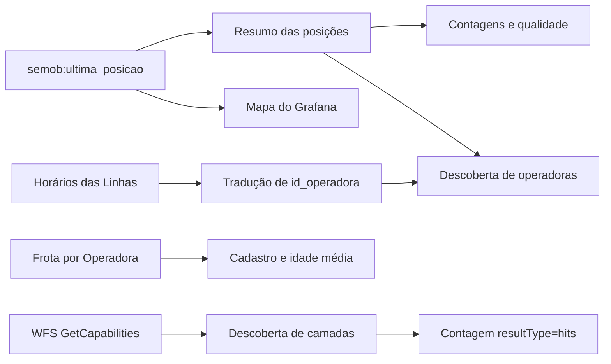

# Dados da SEMOB

A SEMOB não publica um dicionário da API do GeoServer. Este documento reúne o que foi observado nas consultas públicas de leitura e o que as normas e os atos oficiais permitem afirmar. Os números vêm de 09/10/2026, salvo indicação contrária.

Cada afirmação tem uma de três origens, e o texto diz qual.

| Origem | Significado |
|---|---|
| Observado | Resultado de uma consulta ao GeoServer ou de uma coleta do Zabbix |
| Norma ou ato oficial | Texto de portaria, lei ou documento da SEMOB, com o endereço na lista de fontes |
| Hipótese | Interpretação plausível, ainda não confirmada |

## Fluxo de transformação dos dados

As métricas de posição e de cadastro têm fontes e ciclos de atualização distintos. Veículos com sinal recente não equivalem necessariamente a veículos cadastrados nem comprovam viagens realizadas.

## Serviços do GeoServer

O endereço base é `https://geoserver.semob.df.gov.br/geoserver/ows`. A leitura é anônima. O projeto não executou operações de escrita.

| Serviço | Versão consultada | Resultado observado |
|---|---|---|
| WFS | 2.0.0 | HTTP 200, 14 camadas, `DescribeFeatureType` e `GetFeature` funcionando |
| WMS | 1.3.0 | HTTP 200, 10 camadas |
| WMTS | 1.0.0 | HTTP 200, 10 camadas anunciadas, tiles não testados |
| WCS | 2.0.1 | HTTP 200, nenhuma cobertura anunciada |

O WFS anuncia as versões 1.0.0, 1.1.0 e 2.0.0 e os formatos GeoJSON, CSV, GML, KML e SHAPE-ZIP. A paginação é suportada, mas `PagingIsTransactionSafe` é falso. Se os dados mudarem durante uma paginação, páginas podem repetir ou pular registros. O template evita o problema com uma única consulta de `count=10000`.

O GeoServer não envia o cabeçalho `Access-Control-Allow-Origin`. Consultas feitas direto do navegador para outra origem podem ser bloqueadas, e por isso o Infinity usa o parser Backend.

## Camadas

O template monitora 13 das 14 camadas. A camada de passageiros fica fora da descoberta por padrão, porque consultas sem filtro passaram de 20 segundos.

| Camada | Registros | Sistema de coordenadas |
|---|---:|---|
| `semob:ultima_posicao` | 3.619 | EPSG:4326 |
| `semob:Frota por Operadora` | 3.172 | Tabela, sem geometria |
| `semob:Horários das Linhas` | 44.033 | Tabela, sem geometria |
| `semob:Viagens Programadas por Linha` | 49.883 | Tabela, sem geometria |
| `semob:Dados de movimento de passageiros (Quantitativo e Financeiro)` | Não determinado | Tabela, sem geometria |
| `semob:ponto_parada_v2025` | 6.687 | EPSG:4326 |
| `semob:Paradas de onibus` | 5.456 | EPSG:31983 |
| `semob:percuso das linhas` | 1.404 | EPSG:31983 |
| `semob:itinerario_espacial` | 1.404 | EPSG:4326 |
| `semob:ciclovias_existentes` | 2.572 | EPSG:31983 |
| `semob:terminais_onibus` | 41 | EPSG:4326 |
| `semob:estacoes_metro` | 29 | EPSG:31983 |
| `semob:linha_metro` | 29 | EPSG:31983 |
| `semob:faixas_exclusivas` | 15 | EPSG:31983 |

Os registros contam linhas da camada, não entidades distintas. As camadas de horários e de viagens têm um registro por sentido, dia e horário. As duas camadas de paradas diferem em contagem, campos e identificadores, e o projeto não as une.

Os nomes das camadas têm espaços e acentos. Codifique o nome em URLs.

*Figura 1. Contagens de registros recuperadas por `resultType=hits`, com coleta histórica por camada. Contagens não identificam entidades únicas.*

## Camada de posições

A camada `semob:ultima_posicao` guarda a última posição de cada veículo. Em 12,5 minutos de observação, 3.187 dos 3.619 registros mudaram o campo `dataregistro` e mantiveram o mesmo identificador. A camada é atualizada em tempo próximo do real.

| Campo | Tipo | Uso no projeto | Significado |
|---|---|---|---|
| `id_operadora` | Inteiro | Sim | Código da empresa. A tradução para nome vem da camada Horários das Linhas |
| `prefixo` | Texto | Sim | Número de ordem do veículo em que o GPS está instalado, segundo a Portaria SEMOB nº 89/2019 |
| `cd_linha` | Texto | Sim | Código da linha em que o veículo está alocado, segundo a Portaria nº 89/2019. Fica vazio em parte dos registros |
| `velocidade` | Texto | Sim | Velocidade em km/h, segundo a Portaria nº 89/2019. Parte dos valores usa vírgula decimal |
| `direcao` | Texto | Sim | Rumo em graus. A portaria dá o exemplo 090.23 em ponto flutuante, sem definir o referencial. Parte dos valores usa vírgula decimal |
| `latitude`, `longitude` | Decimal | Sim | Coordenadas em EPSG:4326 |
| `dataregistro` | Data e hora | Sim | Instante de gravação em UTC, formato ISO 8601. Hipótese de que seja o horário de chegada ao servidor da SEMOB |
| `datalocal` | Texto | Não | Hipótese de que seja o horário do GPS em horário de Brasília. A Portaria nº 63/2019 exige esse fuso, mas a camada não o declara |
| `imei` | Texto | Não | Número do equipamento de GPS. O projeto não coleta o campo por privacidade |
| `geom_point` | Ponto | Não | A mesma posição em formato de geometria |
| `sentido` | Texto | Não | Sentido da viagem |

A idade de `dataregistro` não prova a idade da posição GPS. Em uma amostra, os campos `dataregistro` e `datalocal` diferiam em cerca de 15 minutos, se `datalocal` for lido como horário de Brasília.

### Qualidade observada

Valores medidos pelo Zabbix em 09/10/2026.

| Verificação | Valor |
|---|---:|
| Registros na camada | 3.619 |
| Com `dataregistro` de até 5 minutos | 3.187 |
| Com `dataregistro` acima de 24 horas | 423 |
| Recentes sem linha informada | 686 |
| Coordenadas nulas, fora da faixa ou iguais a (0,0) | 8 |
| Pares `id_operadora` e `prefixo` repetidos | 1 |
| Velocidades que não convertem para número | 0 |

O template não verifica se a coordenada está dentro do Distrito Federal nem se acompanha a via.

*Figura 2. Comparação entre veículos cadastrados e posições recentes. Valores acima de 100% indicam divergência de bases ou momentos de atualização, não comprovam por si só operação irregular.*

## Camada de frota

| Campo | Uso no projeto | Observação |
|---|---|---|
| `operadora` | Sim | Nome da empresa. Os nomes de pessoas físicas são somados em um grupo |
| `ano_fabrica` | Sim | Base da idade média da frota |
| `data_referencia` | Sim | Base do alerta de cadastro desatualizado. A amostra tinha `2026-10-08Z` |
| `placa_veiculo` | Não | O projeto não coleta placas |
| `numero_veiculo`, `servico`, `tipo_onibus`, `area_util`, `quantidade_passageiros_sentados`, `id_frota` | Não | Não usados |

## Empresas

Os códigos abaixo foram lidos da camada Horários das Linhas em 09/10/2026. A frota cadastrada vem do Zabbix na mesma data.

| `id_operadora` | Empresa | Bacia | Frota cadastrada |
|---|---|---|---:|
| 3437 | Viação Piracicabana | 1 | 613 |
| 3449 | Viação Pioneira | 2 | 754 |
| 3441 | Urbi Mobilidade Urbana | 3 | 565 |
| 3444 | Auto Viação Marechal | 4 | 544 |
| 3450 | Expresso São José | 5 | 603 |
| 3262 | Coobrataete | Não se aplica | 50 |
| Vários | Permissionários do STPCR, somados | Não se aplica | 43 |

A soma é 3.172 veículos, o total da camada.

### Bacias

A nota informativa da SEMOB lista as cinco bacias do serviço básico. A nota registra a Bacia 3 como Viação HP-ITA, com Urbi entre parênteses.

As regiões atendidas só têm fonte para três bacias.

| Bacia | Regiões citadas | Fonte e ano |
|---|---|---|
| 1, Piracicabana | Plano Piloto, Sobradinho 1 e 2, Cruzeiro, Lago Norte, Sudoeste e Octogonal, Varjão e Fercal | Jornal de Brasília, 2013 |
| 2, Pioneira | Gama, Paranoá, Santa Maria, São Sebastião, Candangolândia, Lago Sul, Jardim Botânico, Itapoã e parte do Park Way | Jornal de Brasília, 2012 |
| 5, São José | Brazlândia, Ceilândia, SIA, SCIA, Vicente Pires e parte de Taguatinga | Jornal de Brasília, 2012 |

Não há fonte oficial consultada para as Bacias 3 e 4. As fontes de 2012 e 2013 podem não refletir as linhas de hoje. O projeto não grava regiões no template.

### Coobrataete

A Lei distrital 6.944/2021 identifica a entidade como Cooperativa Brasiliense de Transportes Autônomos, Escolares, Turismo e Especiais do Distrito Federal. É uma cooperativa. A camada de frota a rotula como Bacia 02. O centro médio das posições do código 3262 cai na região leste do Distrito Federal, perto do Paranoá e do Itapoã.

Uma matéria do portal SouBrasília informa que a frota da cooperativa seria ampliada de 35 para 50 veículos, o mesmo número do cadastro.

### Transporte rural, STPCR

O Serviço de Transporte Público Complementar Rural é prestado por permissionários, que são pessoas físicas. O projeto básico da licitação prevê 15 lotes de linhas. O contrato 44929/2021 prevê até 6 ônibus por permissionário, o que combina com as frotas de 1 a 6 veículos no cadastro.

Seis códigos aparecem nas posições, mas não na camada Horários das Linhas. Eles somam 20 registros e o template os classifica como `não identificado`.

### TCB

A Sociedade de Transporte Coletivo de Brasília não aparece nas camadas de frota, de horários nem de posições.

## O que não se sabe

- A SEMOB não publica SLA, limite de requisições, política de retenção nem licença de reutilização. `Fees` e `AccessConstraints` valem `NONE` no catálogo, o que não substitui uma licença.
- O fuso e o significado exato de `datalocal` e de `dataregistro` não estão documentados.
- O referencial de `direcao` não está definido. O projeto o trata como graus a partir do norte.
- Horários e viagens programadas são programação. Eles não provam viagem realizada, pontualidade ou lotação.
- As unidades de `total_credito` e `total_pagantes`, na camada de passageiros, não foram confirmadas.

## Fontes

| Assunto | Fonte |
|---|---|
| Catálogo do WFS | https://geoserver.semob.df.gov.br/geoserver/ows?service=WFS&version=2.0.0&request=GetCapabilities |
| Campos de GPS | Portaria SEMOB nº 89/2019, https://www.sinj.df.gov.br/sinj/Norma/e05f7c611571421a882d3c5bf3a474b5/semob_prt_89_2019.html |
| Fuso do GPS | Portaria SEMOB nº 63/2019, https://www.sinj.df.gov.br/sinj/Norma/65154025984442408f84dafe8a300305/Portaria_63_25_07_2019.html |
| Bacias do serviço básico | Nota informativa da SEMOB, https://semob.df.gov.br/documents/d/semob/nota-informativa-novembro |
| Regiões da Bacia 2 e da Bacia 5 | Jornal de Brasília, https://jornaldebrasilia.com.br/brasilia/gdf-reabre-edital-para-licitacao-do-transporte/ |
| Regiões da Bacia 1 | Jornal de Brasília, https://jornaldebrasilia.com.br/brasilia/plano-piloto-e-varjao-recebem-novos-onibus-neste-sabado/ |
| Nome da Coobrataete | Lei distrital 6.944/2021, https://www.legisweb.com.br/legislacao/?id=420030 |
| Frota da Coobrataete | https://soubrasilia.com/celina-leao-entrega-15-micro-onibus-para-reforcar-linhas-no-paranoa-e-no-itapoa/ |
| Lotes do STPCR | Projeto básico, https://semob.df.gov.br/documents/d/semob/sei_gdf-59753877-projeto-basico |
| Ônibus por permissionário | Contrato 44929/2021, https://semob.df.gov.br/documents/d/semob/sei_gdf-72529366-contrato-44929-2021 |
