# Galeria de telas

As imagens da pasta `galeria/` são capturas históricas dos painéis do Zabbix e do Grafana, não consultas em tempo real. Use os documentos de [instalação](instalacao.md), [arquitetura](arquitetura.md), [dados](dados-semob.md) e [operação](operacao.md) para interpretar os resultados.

## Grafana

### Mapa da frota

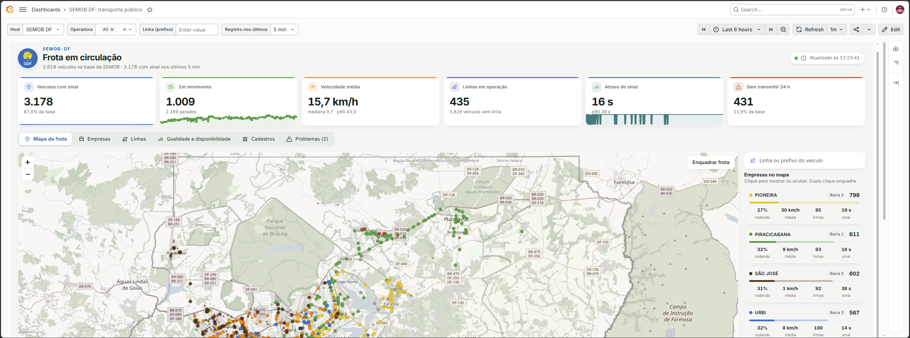

*Figura 1. Painel de mapa, indicadores e filtros operacionais.*

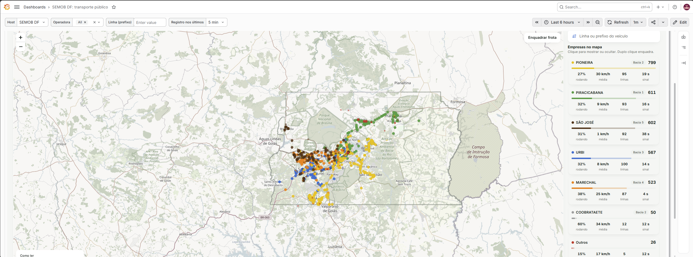

*Figura 2. Captura complementar do mapa. O arquivo é mantido no repositório original.*

### Empresas

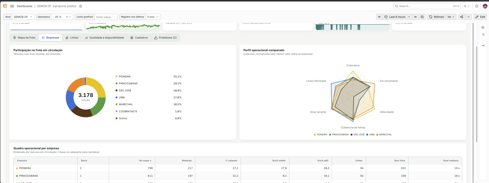

*Figura 3. Distribuição por empresa e gráfico de perfil normalizado.*

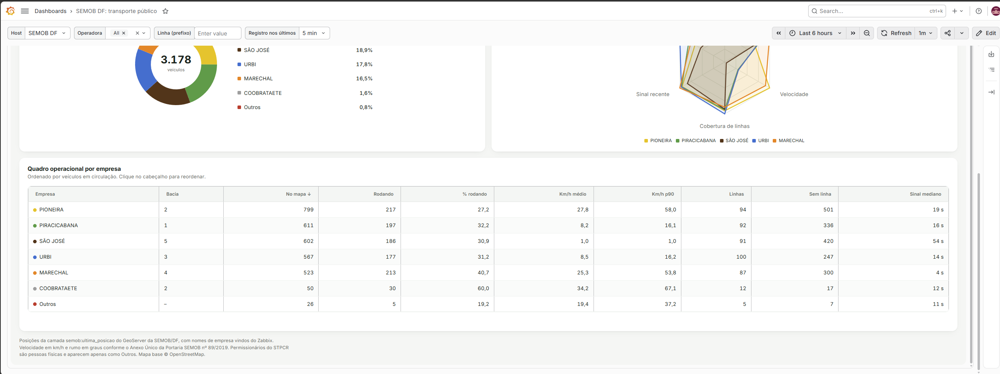

*Figura 4. Detalhe do quadro operacional com médias e contagens.*

### Linhas

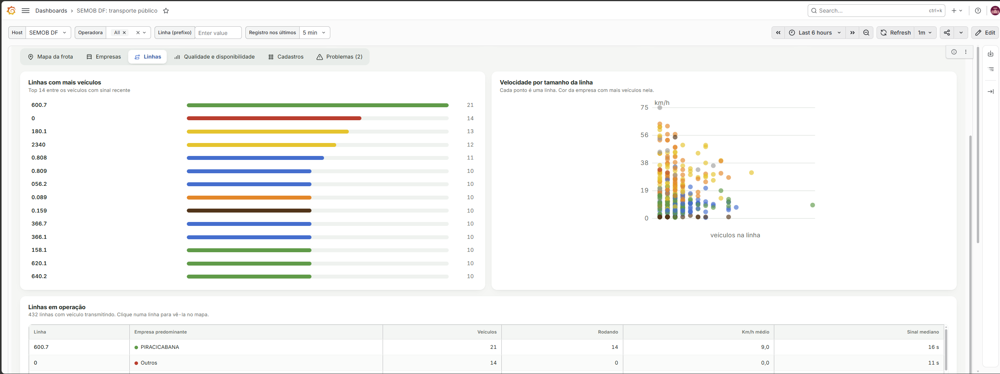

*Figura 5. Ranking, dispersão de velocidades e quadro de linhas.*

### Qualidade e disponibilidade

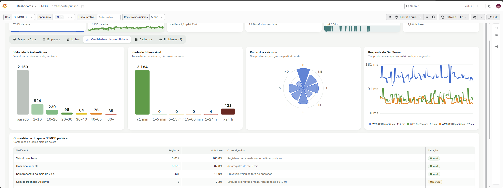

*Figura 6. Indicadores de velocidade, idade do sinal, direção e latência.*

### Cadastros

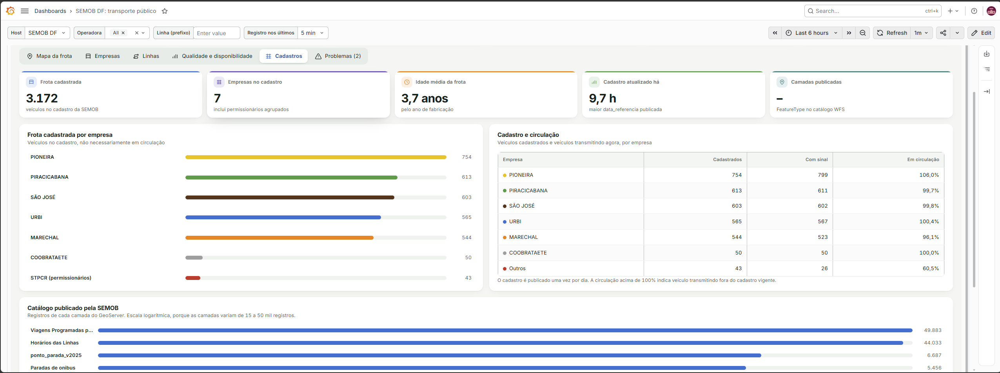

*Figura 7. Frota cadastrada, circulação e distribuição de registros por camada.*

## Zabbix

### Dados recentes

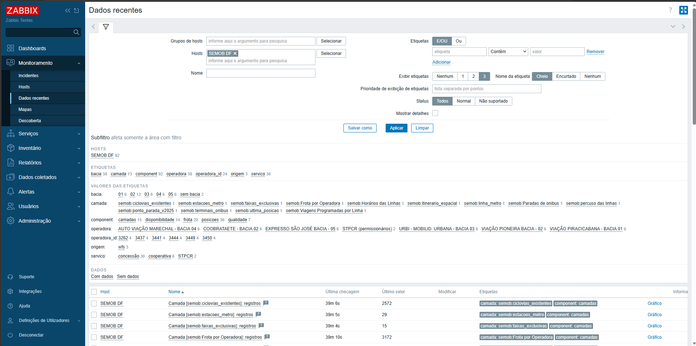

*Figura 8. Filtros e etiquetas dos itens do host.*

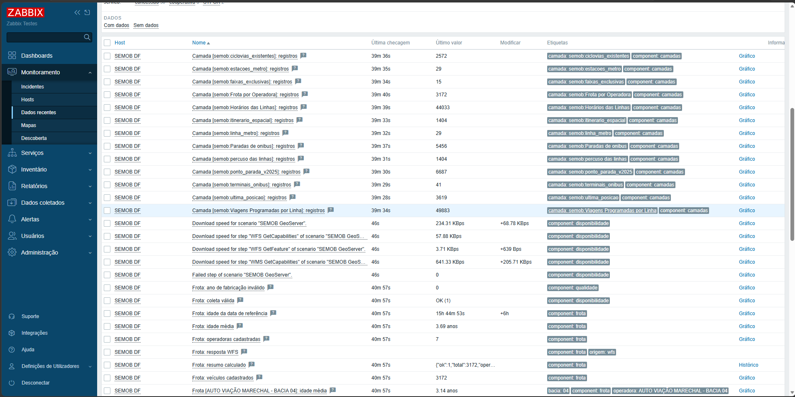

*Figura 9. Itens descobertos e indicadores de frota.*

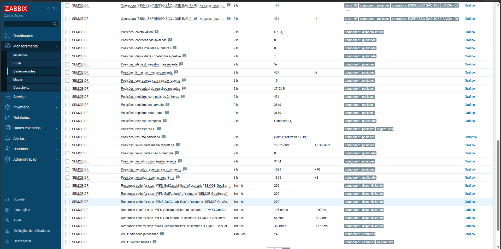

*Figura 10. Itens de qualidade, dados recentes e cenário web.*

### Dashboard do template

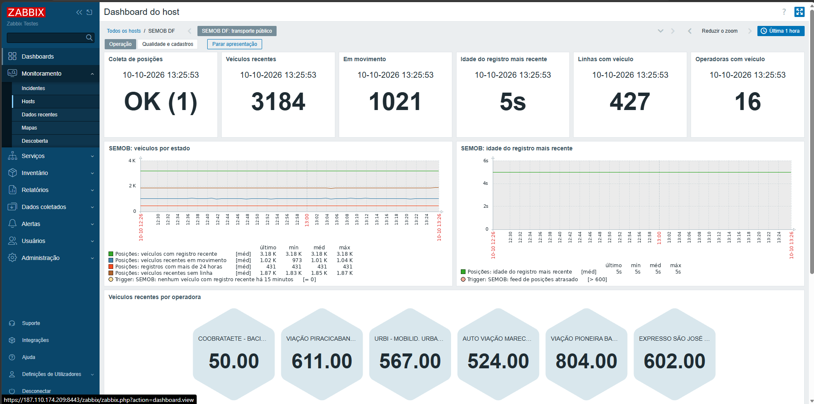

*Figura 11. Página Operação com indicadores e séries temporais.*

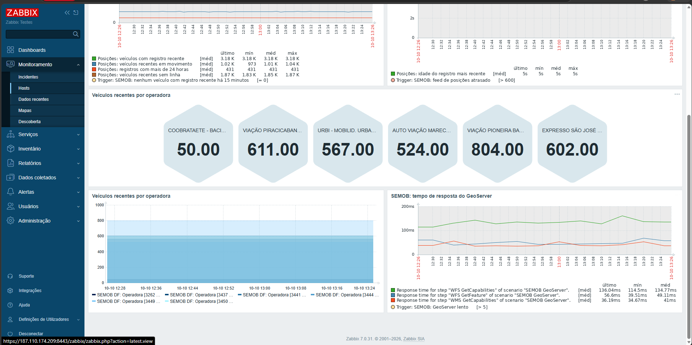

*Figura 12. Séries por operadora e tempos de resposta.*

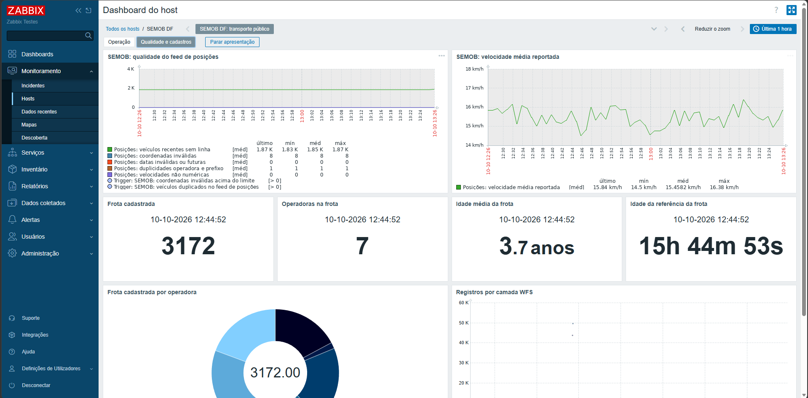

*Figura 13. Indicadores e gráficos da segunda página do dashboard.*

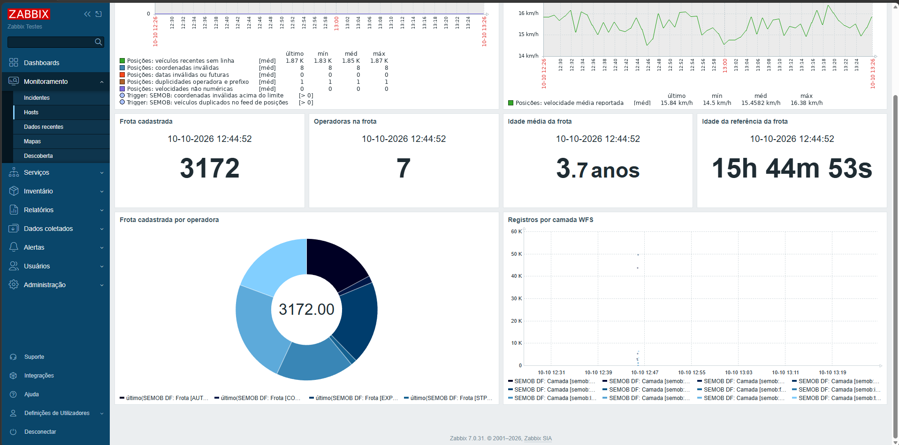

*Figura 14. Distribuição da frota e catálogo das camadas.*

## Observações da revisão

- As capturas representam instantes de coleta diferentes. Não se deve inferir divergência operacional apenas pela diferença entre valores.
- Na Figura 7, o cartão de camadas publicadas aparece sem valor, enquanto a Figura 10 apresenta 14 camadas no Zabbix. Investigue a consulta D no Grafana, sem pressupor a causa.
- Capturas em resoluções elevadas podem exigir ampliação no GitHub. Não foram alteradas, comprimidas nem recortadas.
- O arquivo `Screenshot_2.png` foi incorporado como referência Markdown, mas sua inspeção visual integral não foi possível nesta revisão. A imagem permanece no repositório sem alteração.
