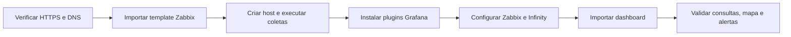

# Instalação

Este guia leva do repositório vazio ao dashboard funcionando. Cada bloco de comandos indica em qual máquina executar.

| Nome usado no guia | Significado |
|---|---|
| Servidor Zabbix | Máquina do Zabbix server, ou do proxy que vai monitorar o host |
| Servidor Grafana | Máquina onde o Grafana roda |
| Estação | Computador de quem usa os frontends do Zabbix e do Grafana |

## Fluxo de instalação



Os passos de instalação do Zabbix e do Grafana são independentes até a validação do dashboard. Não execute os comandos de provisionamento no host errado.

## 1. Testar o acesso ao GeoServer

Execute no servidor Zabbix e repita no servidor Grafana. Os dois precisam alcançar o GeoServer.

```bash
URL='https://geoserver.semob.df.gov.br/geoserver/ows'

curl -sS -o /dev/null -w 'GetCapabilities: HTTP %{http_code} em %{time_total}s\n' \
  "$URL?service=WFS&version=2.0.0&request=GetCapabilities"

curl -sS "$URL?service=WFS&version=2.0.0&request=GetFeature&typeNames=semob:ultima_posicao&resultType=hits"; echo

curl -sS -o /tmp/semob_posicoes.json -w 'Posições: HTTP %{http_code}, %{size_download} bytes em %{time_total}s\n' \
  "$URL?service=WFS&version=2.0.0&request=GetFeature&typeNames=semob:ultima_posicao&outputFormat=application/json&count=10000&propertyName=id_operadora,prefixo,cd_linha,velocidade,latitude,longitude,dataregistro"
```

O resultado esperado é HTTP 200 nas duas consultas e um XML com o atributo `numberMatched`. A terceira consulta grava cerca de 1 MB em `/tmp/semob_posicoes.json`.

Se o servidor sair para a internet por um proxy HTTP, preencha o campo de proxy nos itens HTTP agent e no cenário web do template.

## 2. Importar o template no Zabbix

Pelo frontend, abra Data collection, Templates, Import. Selecione `zabbix/template_semob_df_geoserver_http.yaml` e mantenha as opções padrão.

Pela API, execute em qualquer máquina Linux com acesso ao frontend. O token precisa de permissão de escrita em templates. O comando requer `jq` e `curl`.

```bash
export ZBX_URL='https://SEU_FRONTEND/api_jsonrpc.php'
export ZBX_TOKEN='COLE_O_TOKEN_AQUI'

jq -Rs '{jsonrpc:"2.0", method:"configuration.import", id:1, params:{format:"yaml", source:., rules:{
  template_groups:{createMissing:true},
  templates:{createMissing:true, updateExisting:true},
  items:{createMissing:true, updateExisting:true},
  discoveryRules:{createMissing:true, updateExisting:true},
  triggers:{createMissing:true, updateExisting:true},
  graphs:{createMissing:true, updateExisting:true},
  httptests:{createMissing:true, updateExisting:true},
  templateDashboards:{createMissing:true, updateExisting:true},
  valueMaps:{createMissing:true, updateExisting:true}}}}' zabbix/template_semob_df_geoserver_http.yaml \
| curl -sS -X POST "$ZBX_URL" -H 'Content-Type: application/json-rpc' \
  -H "Authorization: Bearer $ZBX_TOKEN" --data-binary @-; echo
```

A resposta esperada contém `"result":true`. O comando não usa `deleteMissing`, então nada do template existente é removido.

## 3. Criar o host

No frontend do Zabbix, abra Data collection, Hosts, Create host.

| Campo | Valor |
|---|---|
| Host name | `SEMOB DF` |
| Templates | `SEMOB DF GeoServer by HTTP` |
| Host groups | Um grupo de sua escolha |
| Interfaces | Nenhuma. HTTP agent e cenário web não usam interface |
| Monitored by | O server ou o proxy testado no passo 1 |

O nome `SEMOB DF` não é obrigatório para o template. O dashboard do Grafana procura hosts cujo nome contém `SEMOB`.

## 4. Fazer a primeira coleta

O Zabbix agenda a primeira coleta de cada item em um ponto qualquer do intervalo. Itens de 1 hora podem levar até 1 hora para aparecer num host novo. Para coletar na hora, faça o seguinte no frontend do Zabbix.

1. Abra Data collection, Hosts, `SEMOB DF`, Items.
2. Selecione `Posições: resposta WFS`, `Frota: resposta WFS` e `WFS: GetCapabilities` e clique em Execute now.
3. Abra Discovery rules e clique em Execute now na regra `Descoberta de operadoras nas posições`.
4. Aguarde cerca de 1 minuto e repita o passo 2 para preencher os itens recém-descobertos.
5. Abra Monitoring, Latest data, filtre pelo host e confira `Posições: coleta válida` igual a OK e `Posições: resposta completa` igual a Completa.

As regras de frota e de camadas são dependentes e rodam junto com os itens do passo 2.


*Figura 1. Exemplo de filtro pelo host SEMOB DF em Monitoring > Latest data. Os valores da captura servem apenas para localizar os itens.*

## 5. Preparar o Grafana

Execute no servidor Grafana. Os três plugins são necessários.

```bash
grafana cli plugins install alexanderzobnin-zabbix-app
grafana cli plugins install yesoreyeram-infinity-datasource
grafana cli plugins install marcusolsson-dynamictext-panel
sudo systemctl restart grafana-server
```

Em instalações mais antigas, o comando se chama `grafana-cli`. Habilite o app Zabbix em Administration, Plugins, conforme a documentação do plugin.

### Data source Zabbix

No frontend do Grafana, abra Connections, Data sources, Add data source, Zabbix. Informe a URL `https://SEU_FRONTEND/api_jsonrpc.php` e as credenciais de um usuário do Zabbix com permissão de leitura no host `SEMOB DF`.

### Data source Infinity

O Infinity só consulta endereços liberados em Allowed hosts. A forma mais simples é o provisionamento por arquivo.

```bash
cat > /etc/grafana/provisioning/datasources/infinity-semob.yaml <<'EOF'
apiVersion: 1
datasources:
  - name: Infinity SEMOB
    uid: infinity-semob
    type: yesoreyeram-infinity-datasource
    jsonData:
      allowedHosts:
        - https://geoserver.semob.df.gov.br
EOF
chown root:grafana /etc/grafana/provisioning/datasources/infinity-semob.yaml
chmod 640 /etc/grafana/provisioning/datasources/infinity-semob.yaml
sudo systemctl restart grafana-server
systemctl is-active grafana-server
```

O resultado esperado é `active`. Um data source criado por provisionamento fica somente leitura na interface. Para alterar, edite o arquivo e reinicie o serviço.

Como alternativa, crie o data source pela interface e preencha Security, Allowed hosts com `https://geoserver.semob.df.gov.br`.

## 6. Importar o dashboard

No frontend do Grafana, abra Dashboards, New, Import e envie `grafana/dashboard_semob_df.json`. A tela de importação pede dois data sources.

| Campo | Escolha |
|---|---|
| `DS_ZABBIX` | O data source Zabbix do passo anterior |
| `DS_INFINITY` | `Infinity SEMOB` |

O dashboard tem quatro variáveis no topo.

| Variável | Função |
|---|---|
| Host | Hosts do Zabbix cujo nome contém `SEMOB` |
| Operadora | Filtra as empresas. All mostra todos os veículos |
| Linha (prefixo) | Filtra pelo início do código da linha. Vazio mostra todas |
| Registro nos últimos | Idade máxima do sinal, de 5 minutos a 24 horas |

## 7. Conferir

| O que verificar | Resultado esperado |
|---|---|
| Aba Mapa da frota | Mapa com pontos coloridos e cartões das seis empresas, mais Outros |
| Indicadores do topo | Seis cartões com valores e linha de tendência |
| Aba Problemas | Lista de triggers ativas ou aviso de que não há problemas |
| Aba Qualidade e disponibilidade | Tempo de resposta das três etapas do cenário web |

Se algo falhar, consulte [operacao.md](operacao.md).


*Figura 2. Exemplo da aba Mapa da frota, com seis indicadores no topo e filtros de host, operadora, linha e intervalo de sinal.*

O dashboard incorporado ao template Zabbix pode ser conferido diretamente no host:


*Figura 3. Página Operação do dashboard do template, com indicadores, gráficos e itens de operadoras descobertas.*

**Atenção:** esta instalação não foi executada como parte desta revisão documental. As capturas são registros de uma execução anterior.

## Atualizar

Importe o novo YAML com as opções de atualização marcadas. O template mantém os UUIDs, então a importação atualiza os mesmos objetos. No Grafana, importe o JSON de novo e sobrescreva o dashboard, que usa o mesmo `uid`.

Se você importou antes uma versão que criava itens com o nome de permissionários, esses itens deixam de ser descobertos. Eles ficam desativados após 1 dia e são removidos após 7 dias. O histórico do item `Frota: resumo calculado` guarda os nomes antigos por até 7 dias. Para apagar antes, selecione o item e use Clear history and trends.
